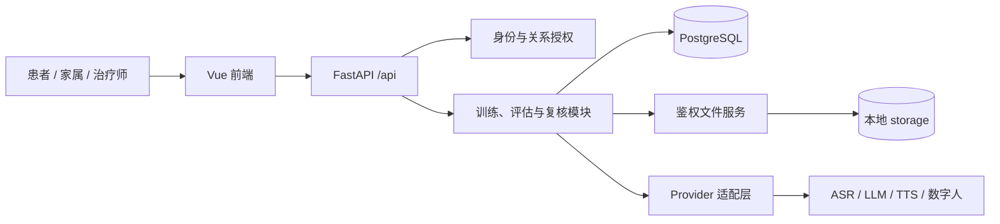
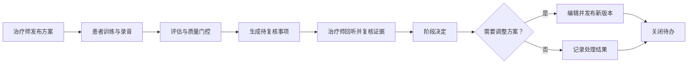

# 言语康复智能体

> 连接患者练习、证据评估与治疗师复核的言语康复训练平台。

本项目面向脑卒中后言语障碍患者，提供跟读、多轮场景表达和数字陪伴训练。患者按治疗师发布的方案练习；治疗师查看原始录音、转写与评估证据，复核结果后决定是否调整方案。系统处于研发与试用准备阶段，支持 Mock 模式和可选云服务接入。模拟数据不进入正式能力趋势，也不作为临床决定依据。

## 项目简介

居家训练需要持续练习，但单个自动分数很难解释患者究竟遇到了什么困难。本项目将训练任务、原始材料、算法结果和人工决定连成可追溯流程：患者获得清晰的练习入口，治疗师能回听原音、检查证据，再调整后续方案。家属端提供经绑定后的陪伴观察入口。平台用于研发演示和试用准备；正式评估与治疗决定由专业人员负责。

## 核心能力

### 患者训练与进展

患者按已发布方案开始或继续当天训练，完成跟读和场景对话；训练支持提示、跳过、求助、暂停、恢复与结束小结。额外练习与正式训练分开记录，进展页区分数据来源与质量，模拟测量不计入正式趋势。

### 治疗师复核闭环

治疗师从待复核队列接手事项，查看原音、原始转写、自动评估及质量原因，确认、修正或标记无法判断；随后形成阶段决定。需要调整时，系统生成可编辑的方案草稿，发布新版本后关闭等待方案的待办，并保留修订与事件记录。

### 目标与版本化方案

治疗师建立康复目标，编排任务顺序、难度与提示策略。已发布方案不原地覆盖；新方案先存为草稿，发布时核对当前生效版本与练习约束，使训练记录能够对应当时的方案。

### 有边界的语音与对话能力

后端通过 Provider 适配语音识别、声学分析、发音评估、语音合成、语义抽取及数字人。多轮对话由场景契约和规则层控制状态与追问目标；可选 LLM 提供带原话依据的语义证据，并在限定动作下生成回复。服务不可用或输出不合约时，使用规则与预设文案回退。

### 数据质量与权限

系统区分真实、模拟、缺失和质量不足的数据；不可用维度不会被当成零分。患者、家属、治疗师和管理员按角色访问，治疗师查看患者还受分配关系约束，媒体文件经鉴权接口读取。

## 效果展示

一次本地演示可以这样进行：患者录制跟读或完成场景对话，并点击“请治疗师关注”；治疗师在待复核队列回听原音、核对转写与评估结果，记录人工判断，再调整并发布方案。演示造数可用于查看界面，但其中的模拟测量不进入正式趋势。

<!-- TODO: 添加患者训练、治疗师证据复核和方案发布的页面截图。 -->

## 应用场景

- **居家练习**：患者按治疗师方案完成练习，在遇到困难时主动求助。
- **治疗师随访**：治疗师按待办定位需要处理的训练，结合原音与证据复核结果。
- **阶段调整**：治疗师依据人工观察和可用数据作出决定，编辑并发布新方案。
- **开发演示**：团队使用试用账号与 Mock Provider 演示流程，再开展真实场景验证。

## 安装部署

以下以当前 `new-UI` 分支的 Windows 本地开发为例。需要 Git、Python 3.11+、Node.js 20+、npm 和 PostgreSQL。先用 pgAdmin 创建名为 `speech_rehab_agent` 的数据库，或在可用的 `psql` 终端执行一次 `CREATE DATABASE speech_rehab_agent;`。仓库目前没有 Docker Compose 配置，Linux 单机部署见[生产部署指南](docs/development/言语康复智能体_生产部署指南.md)。

### 方式一：交给本地 AI 编程工具

在已授权访问本地仓库和开发数据库的 AI 编程工具中使用：

```text
请按本仓库 README 的“安装部署”章节配置本地开发环境：
检查 Python、Node.js 与 PostgreSQL；复制 backend/.env.example；
配置本地数据库连接；安装依赖并执行 alembic upgrade head；
启动 FastAPI 与 Vite，报告 /api/health 和前端访问地址。
```

### 方式二：Windows 一键启动

```powershell
git clone --branch new-UI https://github.com/kinnekovo/AI-recovery.git
cd AI-recovery
Copy-Item backend/.env.example backend/.env
# 编辑 backend/.env 中的 DATABASE_URL 和 SECRET_KEY
.\start-dev.ps1 -InstallDependencies
```

脚本会安装依赖、执行数据库迁移，并在两个 PowerShell 窗口启动服务。首次创建后端虚拟环境时，脚本目前优先调用 `py -3.13`；如果本机只有 Python 3.11/3.12，请先执行 `python -m venv backend/.venv`，再运行脚本。

### 方式三：手动启动

从仓库根目录复制配置文件，确认 PostgreSQL 已运行，然后编辑 `backend/.env`：

```powershell
Copy-Item backend/.env.example backend/.env
```

```env
DATABASE_URL=postgresql+psycopg://postgres:<本地数据库密码>@localhost:5432/speech_rehab_agent
SECRET_KEY=<本地随机密钥>
```

后端终端：

```powershell
cd backend
python -m venv .venv
.\.venv\Scripts\Activate.ps1
python -m pip install -r requirements.txt
python scripts/check_database.py
python -m alembic upgrade head
python -m uvicorn app.main:app --reload --host 127.0.0.1 --port 8001
```

另开前端终端，从仓库根目录进入 `frontend/`：

```powershell
cd frontend
npm install
npm run dev
```

前端地址是 <http://localhost:5173>，后端地址是 <http://127.0.0.1:8001>。访问 <http://127.0.0.1:8001/api/health> 检查服务，交互式 API 文档在 <http://127.0.0.1:8001/docs>。Vite 默认把 `/api` 代理到 `http://localhost:8001`，两端端口需一致。

> 数据库迁移会修改 `DATABASE_URL` 指向的数据库。请确认它是预期开发库；试用账号初始化脚本会更新已有同名账号的密码。

## 快速开始

服务启动后，可在 `backend/` 目录创建本地演示数据：

```powershell
python scripts/init_trial_data.py --patient-count 2 --family-count 0 --password "<仅本地使用的密码>"
python scripts/seed_product_v2_demo.py
```

用 `trial_patient_01` 和 `trial_therapist_01` 登录，密码为上一步指定的值。演示造数包含模拟待办与方案；要检查“原音 → 转写 → 人工复核”，请在患者端录制测试音频并发起求助。更多细节见[试用账号初始化说明](docs/development/言语康复智能体_试用账号初始化说明.md)。

## 使用说明

### 患者

登录后从“首页”进入当天训练，录音、获取提示或发起求助；训练结束后查看小结和“我的进展”。浏览器录音需要麦克风权限。

### 治疗师

从“待复核”进入队列，接手事项后核对原音、转写、评估运行和质量状态，作人工确认、修正或无法判断记录；进入阶段复核并写明理由。若决定调整方案，编辑草稿并发布，再确认来源待办已关闭。

### 开发者

接口位于 `/api`，例如 `POST /api/auth/login`、`GET /api/v2/patient/home` 和 `GET /api/v2/therapist/review-queue`。业务接口需要对应角色的登录凭证；参数与响应以 FastAPI 的 `/docs` 为准。常用检查命令：

```powershell
# 在 backend/ 目录；先安装 python -m pip install -r requirements-dev.txt
python -m pytest tests
python -m alembic heads

# 在 frontend/ 目录
npm run typecheck
npm run test
npm run build
```

## 系统架构



后端是按业务领域划分的模块化单体：Router 接收请求，Service 处理训练、证据和状态转换，SQLAlchemy 模型持久化到 PostgreSQL。媒体文件保存在 `storage/`，数据库记录元数据。第三方服务经后端 `integrations/` 接入，前端不保存云服务密钥。

## 核心工作流程



待办关联患者与来源，人工修订保留原始运行。阶段决定引用冻结的事实范围；调整方案生成草稿，待办保持“等待方案发布”，发布成功后关闭。数据缺失或质量不足时可记录“无法判断”或等待补充。

## AI 与规则工作流程

项目中的“智能体”主要指患者使用的数字陪伴者；当前代码没有自主协作的多 Agent 编排，也没有 RAG 知识库。多轮场景训练使用预设场景契约、信息单元和对话状态规则：


可选 LLM 使用兼容 Chat Completions 的接口。语义抽取只提供可定位到患者原话的证据，不直接生成临床评分；角色回复必须遵守规则层已选定的动作和追问目标。模型不可用或输出不合约时采用规则回退。Prompt 与模型版本随对话证据记录，方便复核。设计依据见[多轮对话训练与评价系统设计](docs/algorithms/场景表达多轮对话训练与评价系统设计.md)和[功能性沟通评价与迭代依据](docs/algorithms/场景表达功能性沟通评价与迭代依据.md)。

## 技术栈

| 层级 | 技术 | 用途 |
| --- | --- | --- |
| 前端 | Vue 3、TypeScript、Vite、Vue Router、Pinia、Axios | 角色页面、训练交互与 API 调用 |
| 后端 | FastAPI、Pydantic、SQLAlchemy 2.x | 业务接口、领域逻辑与数据模型 |
| 数据 | PostgreSQL、Alembic、本地文件存储 | 事务数据、迁移与媒体文件 |
| 语音与对话 | Provider 适配、腾讯云 ASR/TTS/SOE、可选兼容 Chat Completions 的 LLM | 转写、反馈、发音评估和场景对话 |
| 数字人 | 腾讯云适配、静态 2D 回退、阿里云适配器 | 陪练呈现；云能力需单独配置 |
| 开发检查 | pytest、Vitest、vue-tsc | 回归与类型检查 |

## 项目结构

```text
.
├── backend/
│   ├── app/core/             # 配置、安全、日志
│   ├── app/database/         # 数据库会话与模型注册
│   ├── app/modules/          # 训练、评估、复核等业务领域
│   ├── app/integrations/     # 外部语音、LLM、数字人 Provider
│   ├── migrations/          # Alembic 迁移
│   ├── scripts/             # 数据库检查、试用数据与备份脚本
│   └── tests/               # 后端测试
├── frontend/src/
│   ├── features/            # 患者和治疗师主流程页面
│   ├── avatar/              # 数字人客户端适配
│   ├── api/                 # HTTP 客户端与接口封装
│   └── router/              # 角色路由与访问控制
├── storage/                 # 本地媒体；仅占位符入库
├── docs/                    # 产品、架构、算法、开发文档
├── tools/                   # 数字人联调脚本
└── start-dev.ps1            # Windows 本地启动脚本
```

模块说明见[代码库指南](docs/architecture/CODEBASE_GUIDE.md)，文档入口见[文档导航](docs/README.md)。

## 配置说明

完整变量与默认值以 `backend/.env.example` 和 `frontend/.env.example` 为准。

| 变量 | 本地默认或要求 | 作用 |
| --- | --- | --- |
| `DATABASE_URL` | 需指向可用 PostgreSQL 数据库 | 业务数据与迁移 |
| `SECRET_KEY` | 本地可用示例值；部署时必须更换 | 登录令牌签名 |
| `STORAGE_ROOT` | `../storage` | 录音、头像等文件目录 |
| `BACKEND_CORS_ORIGINS` | 本地 5173 端口 | 允许的前端来源 |
| `ASR_PROVIDER`、`SPEECH_EVAL_PROVIDER`、`TTS_PROVIDER` | `mock` | 默认演示链路 |
| `ACOUSTIC_PROVIDER`、`LLM_FEEDBACK_PROVIDER`、`VCL_PROVIDER` | `mock` | 默认不调用外部服务 |
| `PRONUNCIATION_PROVIDER` | `disabled` | 可选发音评估 |
| `TENCENT_AVATAR_ENABLED`、`ALIYUN_AVATAR_ENABLED` | `false` | 可选云数字人 |
| `LLM_FEEDBACK_API_KEY`、`LLM_FEEDBACK_BASE_URL`、`LLM_FEEDBACK_MODEL` | 启用兼容服务时填写 | 场景语义与回复 |
| `VITE_API_PROXY_TARGET` | `http://localhost:8001` | 前端开发服务器 API 代理 |
| `VITE_PRODUCT_V2_ENABLED` | 默认启用；设为 `false` 使用旧版入口 | 页面切换 |

云 Provider 凭据只配置在后端环境文件中。不要把 `.env`、试用音频、头像或备份提交到 Git。

## 性能与扩展

当前是适合本地开发和小规模试用的单体部署，PostgreSQL 与本地文件目录需要一同备份。语音和云 Provider 调用受外部服务时延影响；模型请求设置超时与有限重试，失败时保留回退路径。仓库没有公开的吞吐量基准；若扩大并发规模，需要评估异步任务、媒体存储和数据库容量。

## 安全与使用边界

后端使用登录令牌、角色校验和治疗师—患者分配关系控制访问；文件下载也经过权限检查。头像、声音样本及相关数据使用前需要授权。自动评估、模拟数据与正式量表分开记录；低质量音频和缺失数据不能直接解释为能力下降。真实试用还需按[试用与授权说明](docs/product/言语康复智能体_试用与授权说明.md)落实同意、账户管理和数据保护。

## 项目亮点

- **产品流程**：患者求助进入治疗师待办，通过人工决定和方案发布形成可追踪闭环。
- **证据模型**：保留原音、原始转写、算法版本、质量状态与人工修订，便于解释结果来源。
- **工程边界**：场景规则控制对话行为，LLM 提供受约束的语义证据与表达；默认可在 Mock 模式运行。

## Roadmap

- [x] 患者训练、额外练习与阶段小结的主要页面和接口
- [x] 治疗师待复核、证据修订、阶段决定与方案版本流程的代码实现
- [x] Mock Provider 与可选云服务适配接口
- [ ] 完成端到端手动闭环验收，修复跨角色流程问题
- [ ] 在授权试用中验证语音质量、交互可用性与专业评估一致性
- [ ] 按实际使用量完善部署、监控、备份与数据生命周期管理

## 贡献指南

先阅读[代码库指南](docs/architecture/CODEBASE_GUIDE.md)和相关领域文档。修改 API、数据模型或配置时，同步更新前后端接口、Alembic 迁移与 `.env.example`；提交前按“使用说明”中的命令做相应检查。请通过 Issue 描述场景、复现步骤和预期结果，再提交聚焦单一问题的 Pull Request。不要提交真实患者材料或服务密钥。

## FAQ

### 前端打开后接口请求失败？

先访问后端 `/api/health`，再确认 Vite 代理目标和 Uvicorn 端口一致；当前默认都使用 8001。

### 数据库迁移连接超时？

检查 PostgreSQL 服务、数据库是否已创建，以及 `backend/.env` 的 `DATABASE_URL`。可在 `backend/` 运行 `python scripts/check_database.py` 定位问题。

### 没有云服务密钥能体验吗？

可以。默认 Mock Provider 支持本地交互演示；这类结果会标记来源，不用于正式能力趋势或临床判断。

### 为什么待办没有原音或评估运行？

演示造数中的部分待办只有模拟来源。若要检查原音与人工修订，请用患者账号录制测试音频并在训练中发起求助。

### 可以直接用于临床诊断吗？

不能。平台处于研发与试用准备阶段，自动结果需要质量检查和治疗师复核；正式临床验证与部署要求尚需完成。

## License

仓库目前未提供 `LICENSE` 文件。使用、修改或再分发前，请联系项目维护者确认授权条件。
