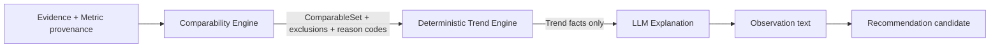

# 新旧产品与领域映射（Phase 0）

## 1. 决策术语

- **KEEP**：语义一致，保留实现。
- **ADAPT**：核心数据/能力可复用，以 adapter、新 DTO 或扩展字段接入。
- **REFACTOR**：内部职责需拆分，但不推翻稳定能力。
- **NEW**：当前无对应领域对象，需要 additive model/application capability。
- **DEPRECATE**：保留兼容期，不再扩展为新版产品核心。

## 2. 新版核心对象映射

| New Concept | Current Implementation | 语义一致性 | 复用/adapter/schema/new | Decision | Reason | Migration Risk |
|---|---|---|---|---|---|---|
| Patient | `User(role=patient)` + `PatientProfile` | 高 | 直接复用；新版状态用 projection，别继续加 UI 字符串 | KEEP | 身份、档案、关系稳定 | 低 |
| Therapist | `User(role=therapist/admin)` + `TherapistPatientAssignment` | 高 | 直接复用；admin 以后分离 presentation | KEEP | 权限与分配已有测试 | 低 |
| RehabilitationGoal | 无；旧 recommendation/profile summary 不等同目标 | 无 | 新表/aggregate，关联 patient、owner therapist、status、effective dates | NEW | 长期目标必须由治疗师控制且可追溯 | 中 |
| TrainingPlan | `training.TrainingPlan` + items；`TrainingRecommendationReview`；Policy V2 | 低 | 建议新建正式 `TrainingPlanVersion`/formal plan aggregate；旧表经 adapter 继续服务旧 UI | NEW | 旧对象只是最新模板集合，无 version/goal/stage/strategy/effective time | 中高 |
| TrainingSession | `training.TrainingSession` | 中高 | 加正式 plan version FK、started/paused/completed/aborted、summary、formal/extra 标记 | ADAPT | 一次训练容器语义成立 | 中 |
| Exercise | `TaskTemplate`（内容模板）+ `SessionTask`（会话实例） | 中 | TaskTemplate 作为模板；SessionTask 适配为 Exercise instance 并保存不可变 snapshot | ADAPT | 当前已能表达跟读/场景和顺序，但模板可变 | 中 |
| ExerciseAttempt | `Attempt`；多轮场景另以 `ScenarioDialogueTurn/Session` 表示 | 高/分叉 | 复用 Attempt；为 dialogue 建统一 adapter/evidence linkage | ADAPT | 基本作答生命周期存在；两条实现路径需统一产品 contract | 中 |
| Metric | `AttemptEvaluation`、`EvaluationDimensionResult`、Assessment JSON、Scenario evaluation | 中 | 以 canonical dimension/metric DTO 统一值、unit、status、source、time、quality；legacy adapters | REFACTOR | 事实已有，但分散且状态模型不一致 | 高（读兼容） |
| Evidence | `FileAsset`、ASR/analysis JSON、scenario turns、prompt fields、EvaluationRun provenance/evidence snapshot、manual raw items | 高但分散 | 新 Evidence reference/DTO；优先引用现有资产，不复制大文件 | ADAPT | 证据链比页面成熟 | 中 |
| Observation | `AttemptScore.main_strength/main_issue`、AbilityProfile summary、profile/policy explanation、stage report text | 低 | 新显式对象，必须引用 Metric/Evidence、标 source/rule/model/version | NEW | 当前观察与反馈/建议混存 | 中 |
| Recommendation | `AttemptScore.suggestion`、`TrainingRecommendationReview`、PolicyDecision payload、stage report recommendation | 低 | 新显式 Recommendation，candidate 状态；adapter 读取旧建议 | NEW | 当前多个建议作用域和审批语义混合 | 中 |
| AttentionItem | assessment/scenario/pronunciation pending review、write failures、旧 pending counts | 低 | 新对象/规则服务；保存 trigger、reason、evidence refs、priority、status | NEW | 当前只有各资源的 pending，不是异常优先工作台 | 中 |
| Assessment | `AssessmentSession` + clinical-stage canonical run | 中高 | 限定为正式施测；保留 metadata/review/comparability；分类 legacy post-training rows | ADAPT | 正式评估基础强，但历史模型仍含训练后语义 | 中高 |
| StageReview | stage report、assessment comparison、Profile V2、Policy V2 等输出组合 | 低 | 新 aggregate/object，输入包引用 plan/sessions/metrics/assessments/observations/attention | NEW | 现有 stage report 是报告，不是决策节点 | 中 |
| TherapistDecision | assessment review、policy feedback、controlled approval | 低 | 新统一 decision record，关联 StageReview/Attention/Plan；复用审计模式 | NEW | 现有 decision 都是局部资源动作 | 中 |
| Milestone | 无正式模型；前端/报告可能自然语言总结 | 无 | 新规则触发事实 + presentation text | NEW | 必须由确定事实触发，不能靠 LLM 猜 | 低中 |

## 3. 关键架构问题的明确答案

### 3.1 新版 TrainingPlan 应复用哪个模型？

**结论：不要把当前 `training.TrainingPlan` 直接升级成新版正式计划；新增正式、版本化的 TrainingPlan aggregate，旧表留 compatibility adapter。**

原因：

- 当前 plan 只有 patient/title/status/items。
- 没有 RehabilitationGoal、Stage Focus、Strategy、version、effective/published/supersedes。
- `get_or_create_today_plan()` 取“最新”而非“今天”，并把活动模板池装入 items。
- 旧 session 已通过 `training_plan_id` 依赖它；直接改变语义会污染历史并破坏旧 UI。

推荐 additive 结构（最终物理命名在 Phase 1 前确认）：

- `rehabilitation_goals`
- `training_plan_versions`（产品层称 TrainingPlan）
- `training_plan_exercise_rules` 或 JSON strategy snapshot
- `TrainingSession.formal_training_plan_version_id` nullable FK

旧 `training_plans` 在代码中逐步重命名为 legacy daily/template plan（不要求立即改表名），通过 adapter 为旧 API 服务。新版 session 一旦绑定正式 plan，就从 plan 生成 Exercise snapshot。

### 3.2 AssessmentSession 与 TrainingSession / Assessment 如何映射？

- `TrainingSession` → 新版 TrainingSession：ADAPT，保持日常训练事实。
- `AssessmentSession` 中带量表 identity/raw/subscale/total/admin/protocol/reviewer 的记录 → 新版 Assessment：ADAPT。
- `AssessmentSession.source_attempt_id`、`post_training` enum 和 process metric compare 是 legacy 混用痕迹，不应用于新写入。
- 日常训练评价继续留在 Attempt/EvaluationRun，不得新建 Assessment。
- 对历史 assessment rows 做只读分类：`formal_assessment`、`legacy_training_derived`、`metadata_insufficient`；不 destructive migrate。

### 3.3 clinical_stage 应该怎样处理？

**保留为内部能力，并重构为 StageReview 的一个支撑输入；不废弃，也不把它直接改名为 StageReview。**

它当前负责正式 assessment 的 canonical record、quality/formal readiness、manual provenance、缺失值语义和可比性。StageReview 则是更高层决策节点，需要结合 plan、训练 sessions、趋势、assessment、observations、attention。两者输入与生命周期不同。

### 3.4 comparability 如何服务三段链？

保留：`assessment/comparability.py`、EvaluationRun provenance/quality/status、ProfileEvidenceLink、formal eligibility rules。

新增/统一：按 metric kind 的 comparability policy，输出 cohort、excluded records、reason codes；Trend Engine 只对可比集合算 slope/delta/stability；LLM 只消费趋势事实并输出解释，不决定是否变化。旧 `process-trend` 和 therapist time buckets 暂作为 legacy projection。

### 3.5 evaluation 如何拆成四层？

| 新层 | 当前来源 | 迁移方式 |
|---|---|---|
| Evidence | audio FileAsset、ASR、target text、prompt level、scenario turns、manual raw items、provenance snapshot | 以引用+snapshot adapter 聚合 |
| Metric | AttemptEvaluation、EvaluationDimensionResult、Assessment result、Scenario scores | 统一 metric status/source/unit/quality/time DTO；canonical run 优先 |
| Observation | main_strength/main_issue、profile trend/summary、stage report observation | 新对象；回链 metric/evidence；旧文本只作 legacy imported observation |
| Recommendation | suggestion、TrainingRecommendationReview、PolicyDecision proposal | 新 candidate object；标 scope、author/model、status、requires therapist approval |

旧 `AttemptScore` 不删除，但不再成为新 API 的一等事实源。

### 3.6 therapist review 如何迁移为 AttentionItem → TherapistDecision？

第一步用 adapter 从以下事实生成 AttentionItem：assessment pending、scenario/pronunciation pending、连续可比困难、依从性、患者主动求助、evaluation write failure、stage review due。AttentionItem 不复制结论，只保存 trigger/evidence link。

治疗师处理后写 `TherapistDecision`：no action、clinical note、adjust plan、add to stage review、request assessment。旧 review API 仍完成资源级确认；controlled approval/audit 模式可复用为 decision audit。计划变更 decision 在同一 application transaction 中创建下一 TrainingPlan version，但只有显式确认才 activate。

## 4. 前端旧→新页面映射

| 新页面 | Current Implementation | Decision | Reason | Migration Risk |
|---|---|---|---|---|
| 患者 Onboarding | 注册 + AgentCreate + assessment 状态 | REWRITE | 当前先创建“智能体”，无一次性初测/计划生成旅程 | 中 |
| 患者首页 | `HomeView` | REWRITE | 有今日雏形但信息架构与状态不完整 | 中 |
| 今日训练 | `TrainingView` + `TrainingSessionView` | REWRITE shell / ADAPT engine UI | 不再让患者选题库；录音/提示/场景能力保留 | 中高 |
| 今日总结 | `TrainingResultView` + Scenario result | REWRITE | 当前只是最后一题或单段对话 | 中 |
| 我的进展 | Evaluation + Report + PatientProfile | REWRITE/CONSOLIDATE | 三个重复页面合成一个 comparability-aware 页面 | 中 |
| 我的 | Agent pages + account actions | NEW shell / ADAPT capabilities | companion/accessibility/privacy 收拢 | 低中 |
| 治疗师工作台 | Dashboard + pending counts | REWRITE | 从试用质控/总量改为 AttentionItem | 中 |
| 患者 workspace | Patients + PatientWorkspace + Profiles monolith | REWRITE | 第一屏需要 goal/plan/change/attention；内部模块折叠 | 高 |
| 单次训练详情 | training record rows + review drawers | NEW aggregate page / ADAPT components | 证据/指标/观察/建议/决策需分层 | 中高 |
| 训练方案 | recommendation/policy/task templates | NEW | 当前没有正式 plan editor/versioning | 高 |
| Stage Review | stage report + clinical stage/profile/policy | NEW | 当前没有决策闭环 | 高 |
| Admin | status/calibration/governance | DEFER | 不优先；能力保持 internal | 低 |

## 5. API 旧→新映射

| 新 application API | 可复用旧 endpoint/service | Decision | 缺口 |
|---|---|---|---|
| Patient Home Query | training today/recommendation/profile | NEW facade | plan/update/session state/ack |
| Start/Resume Training | create/get session | ADAPT | idempotent today session、pause/resume |
| Submit Attempt | attempts/audio/analyze | KEEP core + ADAPT DTO | reliability/status/evidence links |
| Session Summary | reports/process feedback | NEW | session-level facts/observations/recommendations |
| Patient Progress | process trend/scenario trend/profile | NEW facade | unified comparability/milestones/stage review |
| Therapist Workbench | patients/pending counts | NEW facade | AttentionItem |
| Patient Workspace | many therapist endpoints | NEW facade | goal/plan/attention/adherence |
| Training Detail | training records/evaluation run/reviews | NEW facade | unified evidence graph |
| Formal Assessment | therapist assessment APIs | ADAPT | enforce formal semantics and metric status |
| Plan Management | templates/recommendation/policy | NEW | version/publish/activation/history |
| Stage Review & Decision | stage report/compare/policy feedback | NEW | aggregate + decision transaction |

## 6. 旧模块停止继续维护清单

“停止维护”表示不再把新产品需求继续塞入这些旧 presentation 模块；不是本阶段删除。

1. `TherapistProfilesView.vue` 大型旧工作台。
2. `TherapistAssessmentsView.vue` 的“所有自动评估逐条复核”产品模式。
3. 患者 `EvaluationView.vue`、`AbilityProfileView.vue` 与 `ReportView.vue` 三套重叠 IA；只保留到新版 Progress 替代。
4. 独立“我的智能体”一级页面；能力迁入“我的”。
5. 治疗师一级“系统状态”、calibration/governance/policy validation 页面；移入 admin/internal。
6. 把 `AttemptScore` 综合分与自然语言建议作为事实层的展示方式。
7. 把 `AbilityProfile` 旧可变 summary/recommendation 继续扩展为新版画像。
8. 把 legacy `TrainingPlan` 继续扩成正式计划的做法。

## 7. 完全保留、只换 presentation/application layer 的能力

- Auth/JWT/role/assignment/access checks。
- SQLAlchemy engine/session、Alembic chain、PostgreSQL。
- FileAsset/storage/access control、audio upload。
- ASR Tencent abstraction + error redaction/provenance。
- Local acoustic analysis 与质量门。
- TTS/VCL/avatar capability（降级为 companion presentation）。
- Multi-turn scenario state/evidence/review。
- Pronunciation shadow/clinical revision audit。
- EvaluationRun append-only/adoption/revision/failure handling。
- Formal assessment metadata、clinical-stage canonicalization、strict assessment comparability。
- Profile V2 evidence links/snapshots。
- Calibration/validation/governance internal capability。
- 已通过的稳定能力测试。

## 8. 最小第一个垂直切片

**患者首页 → active TrainingPlan v1 → 今日 TrainingSession → 一个跟读 Exercise → 一个 ExerciseAttempt（录音/ASR/声学）→ Session summary → 我的进展单一可比指标。**

必须是真实 plan-driven，不允许再以 query string recommendation 模拟 plan。可以只支持一个 therapist-published seed plan、一个 Exercise 类型和一个进展 metric；但从第一天就要有：正式 plan version、session/attempt evidence、metric status、技术失败不计能力下降、session summary、comparability reason。旧页面/API 同时存在。
