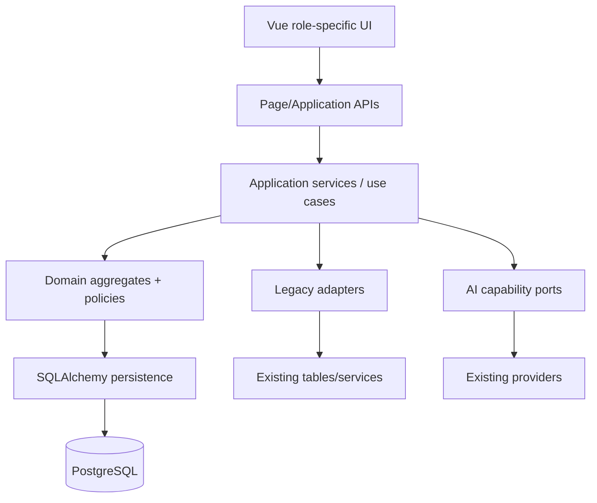
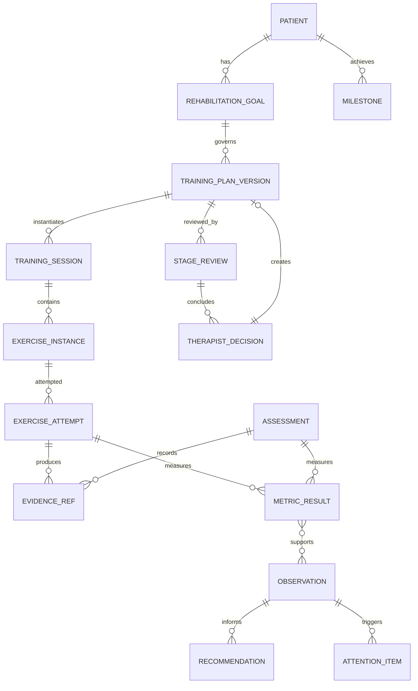

# 新版目标架构（Phase 0 设计）

## 1. 架构目标

目标不是替换现有后端，而是在稳定能力上增加清晰领域层和面向页面的 application API，使产品闭环成为：

```mermaid
flowchart LR
    T[Therapist] --> G[RehabilitationGoal]
    G --> P[Versioned TrainingPlan]
    P --> S[TrainingSession]
    S --> X[Exercise / Attempt]
    X --> E[Evidence]
    E --> M[Metric]
    M --> C[Comparability]
    C --> TR[Trend]
    TR --> O[Observation]
    O --> R[Recommendation / AttentionItem]
    R --> SR[StageReview]
    SR --> D[TherapistDecision]
    D --> NP[New TrainingPlan Version]
```



硬边界：事实层不可由 LLM 覆盖；正式计划与阶段迁移只有治疗师确认后生效；Assessment 只表示正式专业评估。

## 2. 分层设计



### Presentation layer

- 患者固定四导航：首页、训练、我的进展、我的。
- 治疗师固定三导航：工作台、患者、训练方案。
- Admin/internal 工具不进入治疗师 shell。
- 页面消费 product DTO，不直接拼底层表字段。

### Application layer

按用例组织，不按“一个表一个 router”：

- `GetPatientHome`
- `StartOrResumeTodayTraining`
- `SubmitExerciseAttempt`
- `CompleteTrainingSession`
- `GetPatientProgress`
- `GetTherapistWorkbench`
- `GetPatientWorkspace`
- `GetTrainingSessionDetail`
- `Create/PublishTrainingPlanVersion`
- `BuildStageReview`
- `RecordTherapistDecision`

Application service 负责权限、幂等、事务、兼容 adapter、DTO 聚合；领域规则不放在 Vue。

### Domain layer

聚合边界建议：

- RehabilitationGoal aggregate。
- TrainingPlan aggregate（正式 version + activation）。
- TrainingSession aggregate（Exercise/Attempt lifecycle）。
- Measurement aggregate（Evidence/Metric）。
- Insight aggregate（Observation/Recommendation/AttentionItem）。
- Assessment aggregate（formal instrument administration）。
- StageReview aggregate + TherapistDecision。

不要求 Phase 1 一次创建所有表；先建立垂直切片最少对象。

## 3. 目标领域模型



### TrainingPlan

建议字段/不变量：

- patient、rehabilitation_goal、version_number、status(draft/published/active/superseded/ended)。
- stage_focus snapshot。
- training_strategy snapshot：frequency、duration、forms、scene scope/difficulty、max information units、prompt policy。
- effective_from/effective_to、published_by、published_at、supersedes_id。
- 同一患者同一时刻最多一个 active formal plan。
- 历史 plan 不覆盖；计划内容和理由可追溯。

### TrainingSession / Exercise / Attempt

- Session 绑定 formal plan version；可选 `legacy_plan_id` 仅兼容。
- 状态：planned/in_progress/paused/completed/aborted；记录 started/completed/resumed。
- `formal` 与 `extra_practice` 明确区分；只有 formal 纳入计划完成率。
- Exercise instance 保存模板 ID 与不可变 snapshot，避免模板修改污染历史。
- Attempt 记录 retry index、prompt usage、help、skip、technical validity。
- Session summary 由结构化事实生成；LLM 失败用模板，不阻断 complete。

### Evidence / Metric

优先采用 logical object + references，而不是复制现有内容：

- Evidence reference 指向 FileAsset、ASR transcript snapshot、scenario turn、prompt event、task snapshot、manual assessment raw record。
- MetricResult 必含 code/value-or-status/unit/measurement time/source/evidence refs/quality/algorithm or instrument version。
- 状态统一：measured、not_observed、not_administered、invalid、insufficient、not_comparable（UI 再映射规格文案）。
- 正式量表与训练 metric 用 measurement context 区分，不靠名称猜。

### Observation / Recommendation

- Observation：statement、scope、time window、supporting metric/evidence IDs、generator(rule/LLM/human)、version、confidence/limitations。
- Recommendation：candidate action、scope(session/plan/assessment)、basis observation IDs、generator、status(proposed/accepted/modified/rejected/expired)。
- LLM 只能创建候选文字/结构，不写 Metric、Assessment score 或 active plan。

### AttentionItem / Decision

- AttentionItem：type、trigger code、patient、evidence refs、created/priority/status、dedup key、summary。
- 单次波动默认不触发；规则必须使用 comparable sequence 或明确患者行为/系统故障。
- TherapistDecision：decision type、target、reason、actor/time、source Attention/StageReview、payload snapshot、resulting plan version。
- 决策与计划版本创建需事务一致，激活策略需明确。

### Assessment / StageReview

- Assessment 复用 `AssessmentSession` 的强 metadata；新 application API 禁止训练后自动记录进入该表。
- clinical-stage canonical run 继续作为 formal assessment measurement package。
- StageReview 是组合证据包与决策节点，不复制所有 evidence；保存输入集合 fingerprint、系统 observation、candidate recommendation、comparability limitations。

## 4. Application API 目标

### Patient

`GET /api/v2/patient/home`

- user greeting、active plan focus、today session state/structure/duration、primary action。
- recent changes（只来自 comparable trend）。
- plan update announcement/ack state。

`POST /api/v2/patient/training-sessions:start-or-resume`

- 幂等返回当天 formal session；不重复创建。

`GET /api/v2/patient/training-sessions/{id}`

- session/exercises/current index、completed attempts、pending processing、resume info。

`POST /api/v2/.../attempts`、audio、submit/analyze

- 可继续复用旧 command；v2 response 明确 technical status、metric/observation/feedback。

`POST /api/v2/.../complete` 与 `GET .../summary`

- session facts、患者可读 observation、next action；LLM 有模板 fallback。

`GET /api/v2/patient/progress`

- two-week summary、一个可选 trend、milestones、stage review/plan update；数据不足显式状态。

### Therapist

`GET /api/v2/therapist/workbench`

- AttentionItem groups/counts + recent patient overview。

`GET /api/v2/therapist/patients/{id}/workspace`

- goal、active plan、adherence、trends、attention、sessions、assessments。

`GET /api/v2/therapist/training-sessions/{id}`

- overview、Evidence、Metric（含 source/status/comparability）、Observation、Recommendation、decision options。

`GET/POST /api/v2/therapist/patients/{id}/training-plans`

- draft/history/publish；publish 永远创建新 version。

`POST /api/v2/therapist/patients/{id}/stage-reviews`

- 构建 evidence package；随后 decision endpoint 明确确认并可产生新 plan。

旧 endpoint 继续工作；v2 facade 可以先读取旧表，逐步切换到新对象。

## 5. Comparability → Trend → Explanation

### Comparability Engine

输入：metric code/context、task/instrument contract、difficulty、prompt policy、provider/algorithm/instrument versions、quality、time。

输出：

```text
ComparableSet
  included_measurement_ids
  excluded[{id, reason_codes}]
  comparison_key / policy_version
  status: comparable | partially_comparable | not_comparable
```

训练指标可以比较的最低维度应包括 task family、exercise contract version、difficulty/maximum information units、prompt policy、measurement algorithm/provider quality。正式量表沿用现有 instrument/version/locale/unit/admin/protocol 规则。

### Trend Engine

只消费 ComparableSet；确定性计算 delta、slope、median/mean、stability、sample count、time window。数据不足返回 explicit status，不生成方向。

### LLM Explanation

只消费 TrendFact；输出患者/治疗师不同语言层级的 Explanation/Observation。LLM 输出保存 model/prompt version 和引用的 fact IDs；失败使用模板。

## 6. AI capability boundary

| Capability | 自动 | 需要治疗师 | 降级 |
|---|---:|---:|---|
| Exercise generation within active plan | 是 | plan 边界先确认 | 模板题库 |
| ASR/acoustic | 是 | 否 | uncertain/invalid，不猜值 |
| Exercise Observation | 可 | 可复核 | 规则模板 |
| Patient feedback/session summary | 可 | 否 | 模板 |
| Comparability/Trend | 确定性，不用 LLM | 规则版本治理 | no result |
| Trend explanation | LLM 可 | 否 | 模板 explanation |
| Attention trigger | 规则/患者行为 | 否 | 不触发而非乱报 |
| StageReview suggestion | LLM candidate | 最终决定 | 仅事实包 |
| TrainingPlan publish | 否 | 必须 | 无 |
| Assessment scores | 否 | 正式施测/评分 | 未施测 |

现有 provider adapter 继续使用；在 application 层增加 capability contracts，逐步统一 provider status/provenance/fallback，不先重写 provider。

## 7. Frontend architecture

建议按 role + feature/use-case 组织，而不是继续按旧页面堆叠：

```text
frontend/src/
├── app/                    # router, shells, auth bootstrap
├── features/
│   ├── patient-home/
│   ├── training-session/
│   ├── patient-progress/
│   ├── therapist-workbench/
│   ├── patient-workspace/
│   ├── training-plan/
│   └── stage-review/
├── domain-ui/              # Metric/Observation/Recommendation/Evidence components
├── api/v2/                 # page DTO clients
└── legacy/                 # 旧 views/adapters（迁移期）
```

关键 UI 组件：

- `MetricPanel`：只展示事实、来源、时间、状态。
- `ObservationPanel`：必须有“查看依据”。
- `RecommendationPanel`：候选语气与动作。
- `EvidenceDrawer`：audio/transcript/task/prompt/assessment raw。
- `ComparabilityNotice`：comparable/partial/not comparable。
- `AttentionCard`、`DecisionForm`、`PlanVersionCard`。

前端不再自行通过阈值决定“进步/退步”；API 返回 fact/status，前端做规范化文案。

## 8. 新旧系统过渡

### Strangler pattern

1. 新 `/api/v2` facade 与新路由并行上线。
2. 新 formal plan/session 先支持一个患者垂直切片。
3. 旧 training APIs 和旧 views 不删除。
4. legacy adapter 把旧 Attempt/EvaluationRun 映射为新 Evidence/Metric DTO。
5. 新写入 dual-link：新 session 指向 formal plan，同时必要时写旧字段以支持旧报告。
6. 当新闭环覆盖并验证后，旧页面只读冻结，最终才讨论删除。

### Additive-first database

- 新表/nullable FK/索引先行。
- backfill 单独、可重跑、记录 provenance。
- 不重写历史 score，不把 missing 变 0。
- 旧表/列不在闭环完成前删除或改义。
- activation 通过 feature flag/route cohort，而非一次切换所有患者。

### Compatibility rules

- 旧 `TrainingPlan` 仍供 `/training/today`。
- 新 `TrainingPlanVersion` 只供 v2 APIs，直到 cohort 切换。
- 新 Metric query 优先 canonical EvaluationRun，缺失时读取 `AttemptEvaluation` 并标 `legacy_source`。
- 正式 Assessment 原记录不复制；StageReview 引用其 ID/canonical run。
- 旧 summary/recommendation 文本只作为 legacy observation，不自动提升为 clinical fact。

## 9. 事务与失败处理

- 原始上传与 attempt 记录先 durable，再异步/可重试分析。
- provider failure 产生 technical status，不产生能力下降 metric。
- canonical/shadow 派生写延续 `EvaluationWriteFailure` 模式。
- StageReview decision + new plan draft/publish 需要明确事务边界；若 activation 失败，旧 active plan 不变。
- AttentionItem rule 应幂等（dedup key），避免每次刷新重复告警。
- plan update announcement ack 是 presentation state，不改变 clinical decision。

## 10. 可观测性与安全

- 延续 redaction、structured log、provider version、input fingerprint。
- 记录 plan/version、exercise contract、algorithm/instrument version，保证“当时为何训练/如何测量”可回答。
- 权限继续以 assignment 校验；Evidence audio URL 必须走现有 file access control。
- LLM prompt/output 审计不得含不必要的原始敏感数据。
- clinical metric 的 `measured/not administered/invalid/insufficient/not comparable` 不能被空值吞掉。

## 11. 架构决策待确认

Phase 1 前需用户/临床负责人确认：

1. 正式 TrainingPlan 物理命名与旧 `training_plans` 的长期处置（推荐新表）。
2. RehabilitationGoal/Stage Focus 的初始字段与是否允许多 active goal。
3. Plan 生效点：发布即生效，还是患者下一次 formal session 开始时生效。
4. 首个垂直切片的唯一 metric（建议表达完整度或提示独立完成；需明确临床/产品定义）。
5. 接受度是产品体验量表还是临床评估指标；量表、版本、评分者是谁。
6. “WAB 可靠度”的准确临床含义；当前代码完全没有对应字段。
7. 旧 AssessmentSession 如何分类，哪些历史记录可视为正式 Assessment。
8. AttentionItem 首批触发阈值、去重窗口、优先级与 SLA。
9. 患者主动求助是否立即通知治疗师，及通知渠道。
10. Family 端是否明确退出 MVP、只保留 API。
