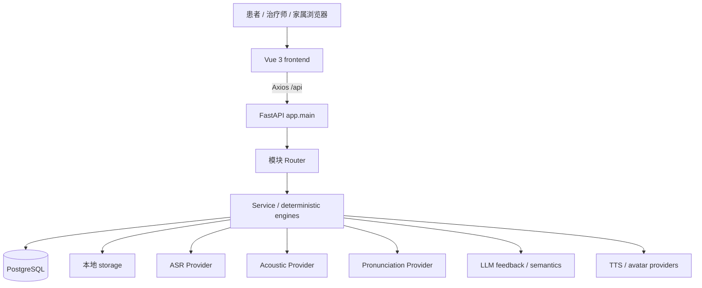
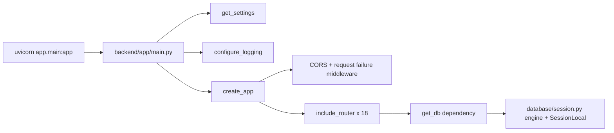
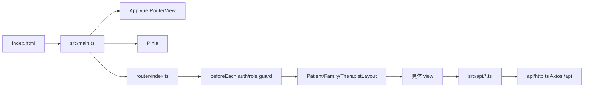
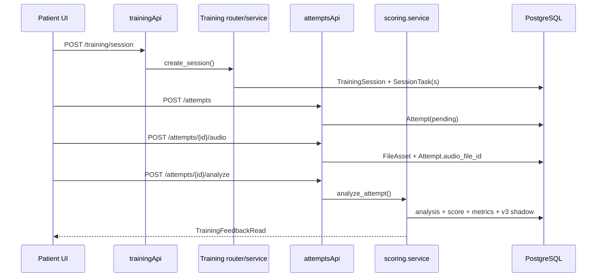
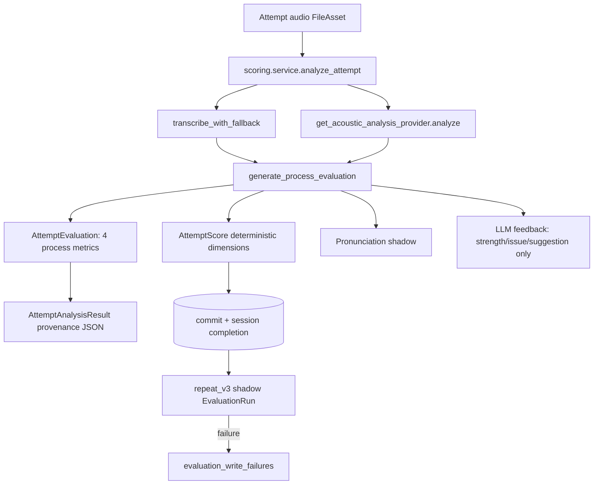
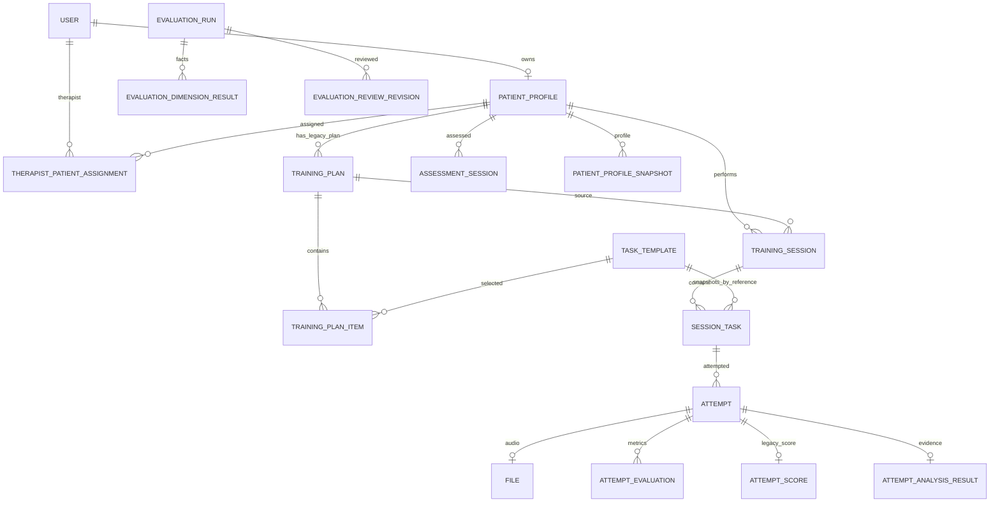

# 言语康复智能体代码库导览（Phase 0）

> 审计日期：2026-09-20  
> 范围：当前工作区（含未提交文件）  
> 新产品基准：`Speech_Rehab_Product_Design_v1.md`、`Speech_Rehab_UI_Interaction_Spec_v1.md`

## 0. 阅读说明与可信度边界

本导览来自源码、Alembic migration、前后端测试和实际测试运行，不以旧阶段总结替代代码事实。审计时用户附件与仓库根目录的两份同名规格 SHA-256 完全一致；规格要求的 `docs/product/` 目录尚不存在。本阶段没有移动规格文件。

仓库在审计开始前已有大量未提交修改和新增文件，尤其包括 `controlled_governance`、迁移 `0039`、治疗师工作区和前端测试。本导览把工作区现状作为审计对象，不判断这些改动是否已准备提交。

标记约定：

- **CURRENT**：当前页面或接口实际使用。
- **LEGACY**：仍可运行，但绑定旧产品语义。
- **INTERNAL**：校准、治理或运维能力，不应进入新版治疗师主流程。
- **UNKNOWN / NEED VERIFICATION**：源码不能证明运行数据或临床有效性。

## 1. 项目总览

这是一个模块化单体 Web 应用。

- Frontend：Vue 3、TypeScript、Vite、Vue Router、Pinia、Axios、ECharts。
- Backend：FastAPI、SQLAlchemy 2.x、Pydantic 2、Alembic。
- Database：PostgreSQL；部分单元测试用 SQLite 内存库。
- 文件：数据库保存 `files` 元数据，本地 `storage/` 保存录音、头像和生成音频。
- AI / provider：ASR、声学分析、LLM 文本反馈、发音评测、TTS、声纹克隆和云数字人均在 `backend/app/integrations/` 后面。
- Tests：后端 pytest；前端 Vitest + Vue Test Utils + jsdom。



本地开发时，Vite 默认监听 `localhost:5173`，并把 `/api` 代理到 `localhost:8000`；FastAPI 由 Uvicorn 启动；后端经 `DATABASE_URL` 连接 PostgreSQL，并按 `STORAGE_ROOT` 访问本地文件。

## 2. 顶层目录结构

```text
言语康复智能体/
├── backend/
│   ├── app/
│   │   ├── core/              # 配置、安全、日志、响应、算法常量
│   │   ├── database/          # Base、engine、Session
│   │   ├── integrations/      # 外部/本地 provider adapter
│   │   ├── modules/           # 业务与应用模块
│   │   └── main.py            # FastAPI composition root
│   ├── migrations/            # Alembic env 与 0001..0039
│   ├── scripts/               # 初始化、连通性、烟测、备份
│   └── tests/                 # 208 个后端测试
├── frontend/
│   ├── src/
│   │   ├── api/               # Axios endpoint wrappers
│   │   ├── components/        # 通用、训练、报告、治疗师组件
│   │   ├── layouts/           # patient/family/therapist shells
│   │   ├── router/            # URL 与角色守卫
│   │   ├── stores/            # auth、agent、training Pinia store
│   │   ├── views/             # 当前页面
│   │   └── main.ts            # 前端入口
│   └── tests/                 # 6 个文件、10 个前端测试
├── storage/                   # 本地大文件，Git 中仅占位文件
├── docs/                      # 版本实施说明；本次新增 refactor/
├── doc/                       # 旧 PRD、设计和阶段记录
├── backups/                   # 存储备份归档
└── README.md
```

目录风险：

| 目录 | 用途 | 核心业务 | 修改风险 |
|---|---|---:|---|
| `backend/app/modules/` | 模型、schema、router、service、确定性引擎 | 是 | 高；跨模块事务与旧接口兼容性强 |
| `backend/app/integrations/` | provider 边界 | 是 | 高；真实服务、隐私和降级语义 |
| `backend/migrations/` | 线性数据库演进 | 是 | 极高；只能 additive-first |
| `frontend/src/views/` | 旧页面与当前工作区 | 是 | 中高；大部分绑定旧 IA |
| `frontend/src/api/` | 前端 API client | 是 | 中；可作为兼容层继续使用 |
| `frontend/src/components/common/` | 异步、状态、确认、时间线等组件 | 部分 | 低到中；可复用 |
| `doc/`、旧 `docs/V*.md` | 历史设计与实施记录 | 否（参考） | 低；不得覆盖新版规格 |
| `storage/`、`backups/` | 用户文件和备份 | 数据资产 | 极高；不可清理或迁移丢失 |

## 3. Backend 启动流程

启动命令：`uvicorn app.main:app --reload --host 127.0.0.1 --port 8000`（工作目录 `backend/`）。



- App 创建：`backend/app/main.py:create_app()`；模块末尾 `app = create_app()`。
- Router 注册：同文件显式 import/register auth、users、agents、avatar sessions、training、attempts、scoring、scenario dialogues、evaluations、evaluation runs、assessment、reports、profiles、profile v2、therapist、family、files、consent、calibration、health。
- Settings：`backend/app/core/config.py:Settings`；先读取 `backend/.env`，再使用环境变量或默认值；`get_settings()` 有 `lru_cache`。
- DB engine/session：`backend/app/database/session.py` 的 `engine`、`SessionLocal`、`get_db()`。
- Model metadata：`backend/app/database/base.py:Base`；`import_models()` 显式导入 model 模块。
- Alembic：`backend/migrations/env.py` 读取 `DATABASE_URL`，调用 `import_models()`，将 `Base.metadata` 设为 `target_metadata`。
- 统一响应：router 通常使用 `backend/app/core/response.py:api_success()`。
- 身份依赖：`backend/app/core/security.py` 与 `backend/app/modules/users/service.py` 提供当前用户/角色约束。

注意：`app.main` 当前没有注册 `policy_v2`、`policy_validation`、`controlled_policy`、`controlled_governance` 的独立 router；相关接口集中挂在 `therapist/router.py`。`scoring/router.py` 目前只有空 router，评分入口实际是 `POST /api/attempts/{id}/analyze`。

## 4. Frontend 启动流程

启动命令：`pnpm dev` 或 `npm run dev`（工作目录 `frontend/`）。



- 入口：`frontend/src/main.ts` 创建 Vue app，安装 Pinia 与 Router。
- 根组件：`frontend/src/App.vue` 只渲染 `<RouterView />`。
- Router：`frontend/src/router/index.ts`。
- Layout：`frontend/src/layouts/PatientLayout.vue`、`FamilyLayout.vue`、`TherapistLayout.vue`。
- API client：`frontend/src/api/http.ts` 设置 `/api`、20 秒超时、Bearer token、统一错误翻译；功能 API 位于同目录。
- Auth state：`frontend/src/stores/auth.ts`，token 保存在 `localStorage.access_token`，`me` 在内存。
- Training state：`frontend/src/stores/training.ts`，只保存当前 session 和最后一题反馈；刷新页面即丢失。
- Agent state：`frontend/src/stores/agent.ts`。

当前主要 URL：

- 患者：`/home`、`/training`、`/training/:type`、`/evaluation`、`/ability`、`/patient/profile`、`/report`、`/agent/*`。
- 家属：`/family`。
- 治疗师：`/therapist`、`/therapist/patients`、`/therapist/patients/:id/:tab`、`/therapist/assessments`、`/therapist/scenario-dialogues/:id`、`/therapist/status`。
- Admin 没有独立 layout/route；router 把 admin 当作可访问 therapist 页面，登录后也重定向 `/therapist`。
- calibration、policy-validation、governance 的旧深链现在重定向到治疗师首页，但对应 view/API 文件仍存在。

## 5. 核心业务模块地图

| 能力 | 功能 | 入口 | 核心 service/engine | model | schema/API | 相关测试 |
|---|---|---|---|---|---|---|
| Authentication | 注册、登录、JWT、角色 | `modules/auth/router.py` | `auth/service.py`、`core/security.py` | `users.User` | `/api/auth/*` | config、权限/API 间接覆盖 |
| Patient | 患者档案、状态 | `users/router.py` | `users/service.py` | `PatientProfile` | `/api/users/me` | family/access tests |
| Therapist | 分配、训练/评估读取、复核 | `therapist/router.py` | `therapist/service.py` | `TherapistPatientAssignment` | `/api/therapist/*` | patient access、reports |
| Training | 模板、旧“今日计划”、session | `training/router.py` | `training/service.py`、`recommendation_policy.py` | `TaskTemplate`、`TrainingPlan`、`TrainingSession`、`SessionTask` | `/api/training/*` | scenario、policy、trial |
| Exercise | 目前由 `TaskTemplate` + `SessionTask` 表示 | training | training service | 无独立 `Exercise` | training schema | scenario contract tests |
| Exercise Attempt | 作答、录音关联、状态 | `attempts/router.py` | `attempts/service.py` | `Attempt` | `/api/attempts/*` | scoring/provider tests |
| Evaluation v2 | 四个过程指标、旧分数/反馈 | attempts analyze | `scoring/service.py`、`evaluations/process_engine.py` | `AttemptAnalysisResult`、`AttemptScore`、`AttemptEvaluation` | `/attempts/{id}/analyze`、`/evaluations/*` | process、safety、quality |
| Evaluation v3 | append-only canonical run | `evaluation_runs/router.py` | repeat/functional/clinical writers | `EvaluationRun`、`EvaluationDimensionResult`、revision/failure | `/evaluation-runs/*` | foundation、mapping、retry |
| Assessment | 正式/阶段记录与复核 | assessment + therapist routers | `assessment/service.py`、`comparability.py` | `AssessmentSession` | `/assessment/*`、therapist assessment APIs | clinical stage、reports |
| Clinical Stage | 正式评估规范化 shadow record | therapist assessment flow | `evaluation_runs/clinical_stage_v3.py` | EvaluationRun domain `clinical_stage` | therapist clinical-stage APIs | 9 个相关 API/service tests |
| Comparability | 正式 assessment 两两可比 | therapist clinical-stage | `assessment/comparability.py` | metadata fields on AssessmentSession | comparison API | clinical stage tests |
| Audio/files | 上传、授权读取、本地存储 | files/attempts/agents | `files/service.py`、`attempts/service.py` | `FileAsset` | `/files/*`、`/attempts/{id}/audio` | file access tests |
| ASR | 转写与失败/回退审计 | scoring/scenario | `integrations/asr/provider.py` | provider snapshot in JSON/evidence | 无独立 API | ASR、observability tests |
| Acoustic | dBFS、时长、暂停、SNR、剪切 | scoring | `integrations/acoustic_analysis/provider.py` | JSON + metrics | 无独立 API | local acoustic/process tests |
| LLM Feedback | 只允许语言反馈；场景语义可接真实 LLM | scoring/scenario | `integrations/llm/provider.py`、`scenario_semantics.py` | JSON snapshots | 无独立 API | LLM boundary、semantic tests |
| Pronunciation | 腾讯 SOE shadow + 人工复核 | therapist/attempts | pronunciation service/provider | analysis/segments/revisions/reviews | therapist pronunciation APIs | provider/privacy/prosody |
| Profile | 旧可变画像 + v2 immutable snapshots | profiles/profile_v2 routers | 对应 services/mapping | AbilityProfile、PatientProfileSnapshot | `/profile/ability`、`/patient/profile` | profile tests |
| Policy | v2 shadow recommendation + controlled session action | therapist router | policy_v2、controlled_policy | policy/approval/audit tables | therapist policy endpoints | policy/validation/governance tests |
| Providers | ASR/acoustic/LLM/TTS/VCL/avatar | service 内 factory | `integrations/*/provider.py` | 无统一 provider model | health 展示状态 | provider tests |

Repositories：代码库没有独立 repository 层；service 直接通过 SQLAlchemy `Session` 查询/写入。这是现状，不要在重构前假定已有 repository abstraction。

## 6. 一次患者训练的完整调用链

当前跟读主分支：



真实文件/函数：

1. `frontend/src/views/patient/HomeView.vue` 调 `trainingApi.today()`、`trainingApi.recommendation()`。
2. `frontend/src/views/patient/TrainingView.vue` 形成推荐链接或允许手选 repeat/scenario。
3. `frontend/src/views/patient/TrainingSessionView.vue:onMounted()` 调 `frontend/src/api/training.ts:createSession()`。
4. `backend/app/modules/training/router.py:create_session()` 调 `training/service.py:create_session()`。
5. `training/service.py:get_or_create_today_plan()` 返回患者最新 `TrainingPlan`；若不存在则创建并把活动模板装入 `TrainingPlanItem`。**它没有日期过滤，所以“today”当前不是每日新计划。**
6. `training/service.py:create_session()` 写 `TrainingSession`、`SessionTask`，并保存 recommendation snapshot。
7. `TrainingSessionView.vue:submitAttempt()` 调 `attemptsApi.create()` → `attempts/service.py:create_attempt()`。
8. 同函数调 `attemptsApi.uploadAudio()` → `attempts/service.py:upload_audio()` → `files/service.py:save_upload()`。
9. 同函数调 `attemptsApi.analyze()` → `attempts/router.py:analyze()` → `scoring/service.py:analyze_attempt()`。
10. 多题推荐组通过 `currentTaskIndex` 在前端推进；全部 `SessionTask` 完成后 `training/service.py:complete_session_if_needed()` 标记 session 完成。
11. `TrainingResultView.vue` 从 Pinia `latestFeedback` 渲染最后一题，不是持久化 Session summary；刷新会丢失。

场景分支不走单次 `attempts/analyze` 主链，而是：`scenarioDialoguesApi.create()` → 多次 `uploadTurn()` → `scenario_dialogues/service.py` 的状态机 → 完整对话 evaluation → `functional_communication_v3` shadow run。它已经具备连续上下文、提示、转写证据和治疗师复核，是新版场景 Exercise 的重要资产。

当前缺口：没有 session pause/resume application contract；刷新 route 会创建新 session；没有正式 SessionSummary；旧计划不是版本化康复计划；额外练习与正式计划指标的边界不完整。

## 7. 一次语音评价的完整调用链

跟读分支从已上传录音开始：



- ASR factory：`integrations/asr/provider.py:get_asr_provider()`；`ASR_PROVIDER=tencent` 才选腾讯，否则 mock。
- ASR fallback：`transcribe_with_fallback()` 捕获真实 provider 错误可回落 mock并标记 `fallback_used`。但 `analyze_attempt()` 会拒绝 mock 结果作为正式评分，写失败状态并返回 422。
- Acoustic factory：`integrations/acoustic_analysis/provider.py:get_acoustic_analysis_provider()`；`local` 使用 NumPy/ffmpeg，本地算 dBFS、voice duration、pause、SNR、clipping；其他值落 mock。正式分析拒绝 mock。
- Process metrics：`evaluations/process_engine.py:generate_process_evaluation()` 确定性生成 `script_accuracy`、`error_count`、`speech_rate`、`loudness`。
- 事实持久化：`AttemptAnalysisResult` 保存 ASR、声学和 provider provenance；`AttemptEvaluation` 保存四指标、unit、algorithm、quality、decision eligibility；`AttemptScore` 保存旧综合分与反馈文本。
- Pronunciation：`pronunciation/service.py:analyze_attempt_pronunciation()` 调 disabled 或 Tencent SOE provider；异常是 shadow failure，不阻断 v2 主评分。
- LLM：`integrations/llm/provider.py` 当前始终返回 `MockLLMFeedbackProvider`；即使配置 real 名称，该通用 feedback factory 仍是 mock。真实 OpenAI-compatible 逻辑只存在于 `llm/scenario_semantics.py`。
- v3：`scoring/service.py:_write_repeat_v3_shadow_nonblocking()` 写 append-only `EvaluationRun`/dimensions；失败回滚 shadow transaction，旧训练结果保持 durable，并记录 `EvaluationWriteFailure`。
- Frontend：`ProcessFeedbackPanel.vue` 把事实指标与规则/LLM反馈仍放在一个结果组件中，尚未按 Metric / Observation / Recommendation 分层。

## 8. 治疗师审核与 Assessment 调用链

### 8.1 正式 assessment

1. `TherapistAssessmentsView.vue` 或 client 调 `POST /api/therapist/patients/{user_id}/assessments`。
2. `therapist/router.py:create_assessment()` 先执行 `require_therapist_patient_access()`。
3. `therapist/service.py:create_patient_assessment()` 写 `AssessmentSession`，治疗师补录直接为 confirmed，并 commit。
4. commit 后 `_write_clinical_stage_shadow()` 调 `evaluation_runs/clinical_stage_v3.py:write_clinical_stage_run()`。
5. clinical writer 把 instrument metadata、raw/subscale/total/missing/protocol deviation 规范化成 `EvaluationRun(domain=clinical_stage)` 与 dimensions。
6. `profiles/service.py:refresh_ability_profile()` 刷旧画像；v3/profile-v2 有独立 snapshot pipeline。

### 8.2 review

`PATCH .../assessments/{id}/review` → `review_patient_assessment()` 更新 metrics/notes/reviewer/status并先 commit → 刷画像 → post-commit clinical-stage shadow write。旧 assessment 不因 shadow 失败而丢失。

### 8.3 comparability

`assessment/comparability.py:compare(a,b)` 只根据量表名/版本、本地化、单位、protocol deviation、missing items、administration mode 和共同 subscale 做事实差值；不推断临床意义。旧 `/assessments/compare` 仍会对 `metrics` 做直接差值，缺少同等严格 gate，应视为 legacy。

### 8.4 evaluation_write_failures

`evaluation_runs.EvaluationWriteFailure` 是 retryable shadow-write 审计：以 source/domain/algorithm/fingerprint 唯一定位写失败，记录 failure stage、error code、retry 次数和 resolved run。它保护 v2 主流程免受 v3 派生写入故障影响，并提供补偿/重试依据；它不是患者训练失败，也不是 AttentionItem，但将来可成为数据异常 AttentionItem 的事实来源。

### 8.5 当前审核队列的真实含义

- Assessment pending review：`AssessmentSession.review_status`。
- 单句场景 review：`ScenarioExpressionReview`。
- 多轮场景 review：`ScenarioDialogueEvaluation.review_status`。
- 发音复核：`PronunciationAnalysisResult` + revisions/intelligibility reviews。
- Policy feedback/approval：`PolicyDecisionFeedback`、`ControlledActionApproval`。

它们是多个资源自己的复核状态，不是统一 AttentionItem，也没有统一 TherapistDecision。

## 9. 数据库模型地图



关键表职责：

| Model / table | 主键/外键 | 生命周期与职责 |
|---|---|---|
| `User / users` | UUID；无 profile FK | 账号、角色、状态；稳定资产 |
| `PatientProfile / patient_profiles` | user unique FK | 患者角色扩展；当前混有 UI 状态字符串 |
| `TherapistPatientAssignment` | therapist user + patient profile | 访问控制与分配；稳定资产 |
| `TaskTemplate` | UUID | 可复用训练内容/场景 contract；可演进为 Exercise template 来源 |
| `TrainingPlan / training_plans` | patient FK | 旧“最新/今日模板集合”；没有 version/effective period/goal/strategy，不等同新版正式计划 |
| `TrainingSession` | patient、legacy plan、agent、recommendation FK | 一次训练；语义接近新版对象，可适配 |
| `SessionTask` | session、plan item、template FK | session 内题目实例；可适配 Exercise，但缺不可变内容 snapshot |
| `Attempt` | session task、audio FK | 一次作答；最接近 ExerciseAttempt |
| `FileAsset` | owner FK | 文件元数据；Evidence 稳定资产 |
| `AttemptAnalysisResult` | attempt unique FK | ASR/声学/LLM JSON 混合证据；可拆读，不应继续扩大混合对象 |
| `AttemptEvaluation` | attempt + metric + source unique | v2 原子指标；可作为 Metric legacy adapter |
| `AttemptScore` | attempt unique FK | 综合分、维度分、反馈混合；legacy presentation result |
| `AssessmentSession` | patient、optional attempt、reviewer/self baseline FK | 当前正式评估容器；字段已能支持量表 provenance，但旧字段允许训练后/attempt 来源 |
| `EvaluationRun` | patient；polymorphic source | append-only canonical evaluation，保存质量门、provenance、adoption；核心稳定资产 |
| `EvaluationDimensionResult` | run FK | 可追溯事实维度；接近新版 Metric |
| `EvaluationWriteFailure` | optional resolved run | 派生写故障与重试审计；稳定资产 |
| `ScenarioDialogue*` | session/task/audio/user FKs | 多轮场景 Evidence、Metric 和复核；高价值资产 |
| `Pronunciation*` | attempt/analysis/user FKs | 发音 evidence、人工修订和可懂度记录；高价值专业资产 |
| `AbilityProfile` | patient unique | 旧可变聚合，混合 summary/recommendation；逐步 legacy |
| `PatientProfileSnapshot` + `ProfileEvidenceLink` | patient/run/assessment FKs | 不可变画像与证据链；可支持新版 Observation/Trend，但不是 UI 领域对象本身 |
| `PolicyDecision*` | patient/profile/session/user FKs | shadow 建议与反馈；不是正式 TrainingPlan 或 TherapistDecision |
| `ControlledAction*` | policy/session/user FKs | 治疗师批准的 session override 与审计；可复用决策审计模式，但作用域过窄 |

旧 UI 驱动/冗余字段包括：`PatientProfile.assessment_status/training_status/onboarding_status`（字符串状态投影）、`TrainingPlan.title/status`（旧今日卡）、`AttemptScore.overall_score` 与多维 display scores、`AbilityProfile.assessment_summary/recommendation`、`TrainingSession.recommendation_*`。这些不能直接删除，但不应定义新版领域。

## 10. Provider 架构

| 环境变量 | 实际控制 | factory / implementation | 默认与重要限制 |
|---|---|---|---|
| `SPEECH_EVAL_PROVIDER` | 仅 settings/health 展示 | 没有业务 factory | 默认 mock；当前实际上未驱动评分 |
| `ASR_PROVIDER` | 训练和对话 ASR | `asr/provider.py:get_asr_provider` | `tencent` 为真实；否则 mock；真实失败可 fallback，但正式评分拒绝 mock |
| `ACOUSTIC_PROVIDER` | 声学质量与指标 | `acoustic_analysis/provider.py:get_acoustic_analysis_provider` | `local` 为真实计算；否则 mock；正式评分拒绝 mock |
| `LLM_FEEDBACK_PROVIDER` | 通用反馈名、场景语义/回复 | `llm/provider.py`、`llm/scenario_semantics.py` | 通用 feedback 始终 mock；场景模块在配置完整时可 OpenAI-compatible |
| `PRONUNCIATION_PROVIDER` | 精细发音 shadow | pronunciation provider factory | `tencent_soe` 或 disabled |
| `TTS_PROVIDER` | 陪伴者语音 | `tts/provider.py:get_tts_provider` | mock/tencent/windows |
| `VCL_PROVIDER` | 声音克隆 | `voice_clone/provider.py` | mock/tencent |

Provider abstraction 不一致：有的以 `provider_name`，有的以 `name`；fallback 语义不同；API key/base URL 字段为某些尚未实现 provider 预留；`SPEECH_EVAL_PROVIDER` 已成为无行为的 compatibility config；LLM feedback 与 scenario semantics 使用两套实现路径。

## 11. API 地图

以下省略统一 `/api` 前缀。

### Auth / User（KEEP）

| Method | Path | Handler | 用途 |
|---|---|---|---|
| POST | `/auth/register` | `auth.router.register` | 患者注册 |
| POST | `/auth/login` | `auth.router.login` | 登录/JWT |
| GET | `/users/me` | `users.router.me` | 当前用户与 patient profile |
| PUT | `/users/current-agent/{id}` | `users.router.set_current_agent` | 选择陪伴者；ADAPT 到“我的” |

### Patient training（CURRENT，但页面 API 需 aggregate）

| Method | Path | Handler | 用途 |
|---|---|---|---|
| GET | `/training/types` | `training_types` | 训练类型 |
| GET | `/training/today` | `today` | 旧今日计划计数/状态 |
| GET | `/training/recommendation` | `recommendation` | 旧推荐任务组 |
| POST | `/training/session` | `create_session` | 新建训练会话 |
| GET | `/training/session/{id}` | `get_session` | 会话与 tasks |
| POST | `/training/avatar-speech` | `create_avatar_speech` | 生成/缓存 TTS |
| POST | `/attempts` | `create_attempt` | 新建作答 |
| POST | `/attempts/{id}/audio` | `upload_audio` | 上传录音 |
| GET | `/attempts/{id}` | `get_attempt` | 作答状态 |
| POST | `/attempts/{id}/analyze` | `analyze` | ASR→声学→指标→反馈 |
| GET | `/attempts/{id}/evaluation-v3` | `evaluation_v3` | v3 canonical result |

### Scenario dialogues（KEEP/ADAPT）

POST/GET `/scenario-dialogues`，GET evaluation/evaluation-v3，POST hint/finish/turns/turns-audio；handlers 位于 `scenario_dialogues/router.py`。它们适合成为新版 scenario Exercise adapter，但需要归入 session/attempt contract。

### Evaluation / Assessment（KEEP core，ADAPT application API）

- `/evaluations/metrics`、`/evaluations/process-trend`、`/evaluations/attempts/{id}`：旧 metric catalog/趋势/人工写入。
- `/evaluation-runs/{id}`、reviews、recompute：canonical evaluation professional API。
- `/assessment`、`/assessment/history`、`/assessment/compare`：患者自身 assessment API；新版应限制为正式 Assessment 语义。
- therapist assessment create/list/review/clinical-source/clinical-stage/compare：专业评估与审计。

### Therapist（多数为旧 workbench/INTERNAL）

- 患者与分配：GET `/therapist/patients`，POST/DELETE patient assignments。
- 训练资料：task templates CRUD、training records/trends/stage report/export。
- 复核：scenario review、多轮 dialogue detail/review、pronunciation revisions/intelligibility/complete-review。
- 旧推荐：training-recommendation、recommendation-note、effects、strategy-feedback。
- Profile V2：latest/history/evidence/rebuild。
- Policy V2：shadow/latest/history/detail/explanation/feedback/observe。
- Controlled actions：proposal/approve/reject/apply/rollback/observe/history。
- INTERNAL：policy validation、controlled governance、calibration。
- 运维：trial-quality、phase3 demo-status、health/status。

### Files / Agent / Consent / Family

这些接口覆盖文件访问、陪伴者配置/授权、数字人 session、家属绑定与只读 observation。底层能力可保留，但新版 MVP 页面不应让 Agent/Family 主导信息架构。

新版页面 API 缺口：

- 患者首页需要一个 `home/today` aggregate：active formal plan、今日 session 状态、结构/时长/重点、最近变化、plan-updated ack。
- 训练需要 session resume、attempt lifecycle、hint events、session summary 与正式/额外练习标记。
- 我的进展需要 comparability-gated trend + observations + milestones + last stage review aggregate。
- 治疗师工作台需要统一 AttentionItem query；当前只能拼多个 pending 状态。
- 患者工作空间需要 plan + adherence + observations + attention + sessions + assessments 聚合。
- 单次训练详情需要 Evidence/Metric/Observation/Recommendation 分层 aggregate。

## 12. Test 地图与 baseline

### 结构

- 后端 `backend/tests/`：208 tests，主要是纯 service/engine 单测、provider parsing、SQLite in-memory model/service tests、FastAPI `TestClient` contract/权限测试。
- 前端 `frontend/tests/`：6 个文件、10 tests，覆盖 API contracts、router permissions、async state、status mapping、patient profile、controlled actions。
- 后端没有统一 `conftest.py`；许多测试在类内创建 SQLite engine/session 或直接构造对象。
- 真实 PostgreSQL migration compatibility、完整浏览器 E2E、真实 provider 集成不属于当前完整测试集。

### 2026-09-20 实测 baseline

- 后端：`208 passed in 6.44s`（Python 3.13.9，pytest 9.1.1）。仓库未声明 pytest 且无 venv，本次从临时目录运行；没有改 `requirements.txt`。
- 前端：`6 passed test files / 10 passed tests in 21.58s`。
- Alembic：单一 head `0039_controlled_governance`，连接的当前数据库也标记在该 head。

长期保留：provider边界、错误脱敏、文件权限、治疗师访问、evidence gate、v3 append-only/retry、comparability、clinical assessment、scenario contract/state、policy safety 等测试。未来替换：绑定旧页面导航、旧 dashboard、旧 combined result、旧 TrainingPlan“today”语义的测试。当前测试没有失败，不得通过改测试制造新版语义。

## 13. 配置与环境变量地图

变量读取集中在 `backend/app/core/config.py`；`.env.example` 提供示例；禁止把真实 secret 写入文档。

核心变量：

- App/DB：`SECRET_KEY`、`ACCESS_TOKEN_EXPIRE_MINUTES`、`BACKEND_CORS_ORIGINS`、`LOG_LEVEL`、`DATABASE_URL`、`DATABASE_CONNECT_TIMEOUT_SECONDS`、`STORAGE_ROOT`。
- Speech：`SPEECH_EVAL_PROVIDER`（当前仅 health）、`ASR_PROVIDER`、`ASR_*`、Tencent credentials/app/region/model/format。
- Acoustic：`ACOUSTIC_PROVIDER`、`ACOUSTIC_*`、`FFMPEG_BIN`；默认 mock，正式需要 local。
- LLM：`LLM_FEEDBACK_PROVIDER/API_KEY/BASE_URL/MODEL`；通用 feedback 尚无真实 implementation。
- Pronunciation：`PRONUNCIATION_PROVIDER` 默认 disabled，Tencent SOE 配置，shadow 默认 true。
- TTS/VCL/avatar：对应 provider、Tencent、Windows、Aliyun 配置。

默认 DB URL 是本地 PostgreSQL；默认所有主要生成 provider 是 mock/disabled。**默认配置下当前 `analyze_attempt()` 会因 mock ASR 或 acoustic 拒绝产生正式评分**，因此 README 中“mock 模式可完成分析反馈”的表述与当前代码不完全一致。

## 14. “我要改 X，应该去哪里？”

| 要修改 | 首先阅读 |
|---|---|
| 患者首页 | `views/patient/HomeView.vue`、`api/training.ts`、`training/service.py:get_today_training` |
| 患者训练页 | `TrainingView.vue`、`TrainingSessionView.vue`、`training/service.py:create_session` |
| 录音 | `RecorderPanel.vue`、`services/recorder.ts`、`attempts/service.py`、`files/service.py` |
| 单题反馈 | `ProcessFeedbackPanel.vue`、`scoring/service.py`、`process_engine.py` |
| 我的进展 | `EvaluationView.vue`、`ReportView.vue`、`evaluations.service.list_process_trend`、reports service |
| 能力画像 | `PatientProfileView.vue` / 旧 `AbilityProfileView.vue`、`profile_v2/*` / `profiles/*` |
| 治疗师患者详情 | `PatientWorkspaceView.vue`、`therapist/router.py/service.py` |
| 治疗师旧大工作台 | `TherapistProfilesView.vue`（965 行） |
| Assessment | `assessment/model.py/schema.py/service.py`、therapist assessment endpoints |
| Clinical stage | `evaluation_runs/clinical_stage_v3.py`、`assessment/comparability.py` |
| ASR | `integrations/asr/provider.py`；调用方 `scoring/service.py`、scenario router |
| 声学/语速/响度 | `acoustic_analysis/provider.py`、`evaluations/process_engine.py`、`process_metrics.py` |
| WAB/CADL | `assessment/schema.py/model.py`、`clinical_stage_v3.py`；当前没有自动评分器 |
| 场景对话 | `scenario_dialogues/*`、`llm/scenario_semantics.py`、相关前端 views |
| 比较规则 | `assessment/comparability.py`、v3 provenance；旧 process trend 另在 evaluations service |
| API schema | 各模块 `schema.py` + `frontend/src/types/*.ts` |
| 新 provider | 对应 `integrations/<capability>/provider.py` + config + health + provider tests |
| 新专业指标 | 先定义 provenance/measurement/status，再看 `EvaluationDimensionResult` 和 metric registry；不要只加 UI 卡片 |
| Migration | `migrations/versions/`、`database/base.py:import_models`、`migrations/env.py` |
| 权限 | `core/security.py`、`therapist/service.py:require_therapist_patient_access` |
| 失败审计 | `evaluation_runs/service.py`、`EvaluationWriteFailure`、observability/redaction |

## 15. 当前最容易混淆的概念

- **TrainingPlan**：名字像正式康复计划，实际是患者最新的一组可选模板；`get_or_create_today_plan()` 没有日期和版本。
- **TrainingSession**：确实是一次训练容器，但 pause/resume、summary、formal vs extra practice 尚未建模。
- **SessionTask**：接近 Exercise 实例，但依赖可变 TaskTemplate，缺完整 immutable snapshot。
- **Attempt**：接近新版 ExerciseAttempt；是最清晰的可复用映射之一。
- **AssessmentSession**：现在的写入口已偏正式人工量表，但 enum/optional attempt/legacy compare 仍带“训练后自动评估”历史语义；不能等同 TrainingSession evaluation。
- **evaluation**：同时指 v2 原子 metric、旧 score/feedback、v3 canonical run、正式 assessment；新版必须在 API 和 UI 层拆名。
- **clinical_stage**：不是患者康复阶段，也不是 StageReview；它是正式 assessment 的规范化记录和可比性支撑。
- **review**：可能是 assessment review、scenario review、pronunciation review、policy feedback 或 controlled approval，没有统一工作项。
- **metric**：`EvaluationMetric/AttemptEvaluation`、`EvaluationDimensionResult`、Assessment JSON 和前端 score card 都叫 metric，但 provenance/状态不同。
- **Observation / Recommendation**：现有代码多以 summary、main_issue、suggestion、recommendation、decision payload 混存，没有独立统一对象。
- **Profile**：旧 `AbilityProfile` 是可变聚合；Profile V2 是不可变 snapshot，二者并存。

## 16. 推荐阅读顺序

1. 两份新版 Product Design / UI Spec。
2. `backend/app/main.py`、`core/config.py`、`database/session.py`、`database/base.py`。
3. `modules/users/model.py`、`training/model.py`、`attempts/model.py`。
4. `training/service.py:get_or_create_today_plan/create_session`。
5. `attempts/router.py`、`scoring/service.py:analyze_attempt`。
6. `evaluations/process_engine.py`、`evidence_gate.py`、`evaluation_runs/*`。
7. `assessment/model.py/service.py/comparability.py` 与 `clinical_stage_v3.py`。
8. `scenario_dialogues/*`、pronunciation、provider implementations。
9. `profile_v2/*`、`policy_v2/*`、controlled policy/governance（理解为内部 capability）。
10. `frontend/src/router/index.ts`、三个 layout。
11. 患者 Home/Training/TrainingSession/Progress 相关 views 与 API wrappers。
12. 治疗师 Patients/PatientWorkspace，再读旧 monolith `TherapistProfilesView.vue`。
13. Alembic 0001、0003、0005、0012、0027-0039 和对应测试。

读完上述顺序后，再把 `doc/` 和旧 `docs/V*.md` 当历史解释材料；若与新版两份规格冲突，以新版规格为准。
